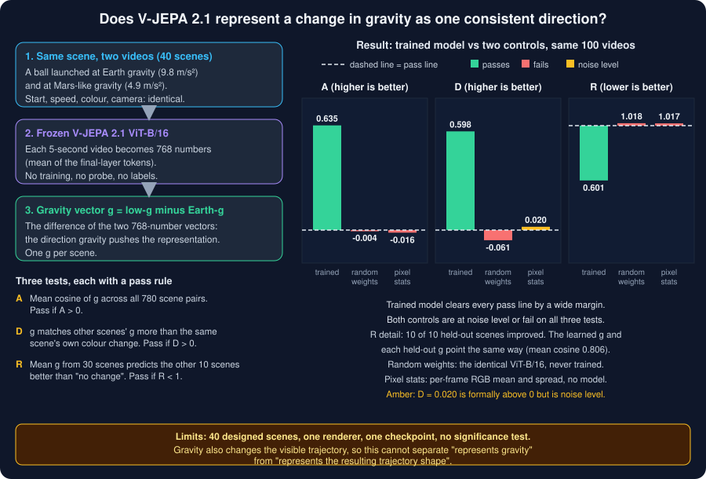

# Latent states in V-JEPA 2.1

**Question:** does a frozen V-JEPA 2.1 ViT-B/16 video model represent a change in gravity as one consistent direction in its embedding space, without any fine-tuning, probe or label?

**Answer in this experiment:** yes, on 40 simulated scenes and one checkpoint. All three tests passed, and the two controls (same architecture with random weights, and plain pixel statistics) did not.



## Definitions

| Term | Meaning |
| --- | --- |
| Scene | A ball launched on a ballistic path: `x(t) = x0 + 15t`, `y(t) = y0 + 10t - 0.5·g·t²`. 40 scenes, each rendered twice (Earth gravity 9.8 m/s², Mars-like 4.9 m/s²) with everything else identical. |
| Colour control | In 20 of the 40 scenes, a third video where only the ball colour changes (orange to blue) and gravity stays at 9.8. |
| Embedding `z` | 768 numbers per video: the mean of the frozen encoder's 4608 final-layer tokens over 16 frames (frames 0, 10, ..., 150 of a 151-frame, 5-second video, 384 px). |
| Gravity vector `g` | `z(low gravity) - z(Earth gravity)` for one scene. |
| Colour vector `c` | `z(changed colour) - z(original colour)` for one scene. |
| Cosine | Similarity of two vectors' directions: 1 same, 0 unrelated, -1 opposite. |
| **A** (H1) | Mean cosine between the `g` of every pair of scenes (780 pairs). Pass if `A > 0`. |
| **D** (H2) | Mean over the 20 colour-control scenes of: (that scene's mean cosine with the other 39 scenes' `g`) minus (cosine of its `g` with its own `c`). Pass if `D > 0`. |
| **R** (H3) | Take the mean `g` of 30 training scenes, add it to the Earth-gravity embedding of each of the 10 held-out scenes, and measure the error against the real low-gravity embedding. `R` = that RMSE divided by the RMSE of predicting "no change". Pass if `R < 1`. |

## Results

| Test | Trained V-JEPA 2.1 | Random weights (same architecture) | Pixel statistics (no model) | Pass rule |
| --- | --- | --- | --- | --- |
| H1: `A` | **0.6348** | -0.0038 | -0.0156 | `A > 0` |
| H2: `D` | **0.5984** | -0.0613 | 0.0200 (noise level) | `D > 0` |
| H3: `R` | **0.6010** | 1.0175 | 1.0167 | `R < 1` |

- **H3 detail:** the mean-`g` prediction cuts the held-out RMSE by 39.9% compared with predicting no change (transport RMSE 0.419). All 10 held-out scenes improved individually, and the learned direction has mean cosine 0.806 with each held-out scene's true `g`.
- **H2 detail:** matched gravity-colour cosines average about 0.029, so the two changes are close to orthogonal in this space.
- **Controls:** the same 100 videos and the same analysis code. They were added after the headline result.
- **Not saturated:** A and D are well below 1, so there is real scene-to-scene variation. It is one useful direction, not one exact axis.

Raw numbers, per-scene tables and every formula: [`REPORT.md`](REPORT.md), [`design/02_MATHEMATICAL_PLAN.md`](design/02_MATHEMATICAL_PLAN.md), [`results/`](results/).

## Limits

- **Descriptive only.** The 40 scenes are a designed grid, not a random sample. No p-values or confidence intervals are computed.
- **One renderer, one checkpoint.** Nothing here says whether the signal holds on real video or another model.
- **Trajectory confound.** Gravity necessarily changes the visible trajectory, so the experiment cannot separate "represents gravity" from "represents the resulting trajectory shape".
- **One colour control.** Orange to blue also changes luminance. It is not a test of all appearance changes.
- **Encoder only.** The V-JEPA predictor network was never run, so this does not test its forecasting or planning claims.

## Status by category

| Category | Done | Pending (planned) | Not planned (gaps) |
| --- | --- | --- | --- |
| **Design** | Hypotheses, stimuli, maths, workflow, checklist in `design/`; `scene_plan.json` | - | - |
| **Stimuli** | 100 clips rendered (lossless FFV1, about 34 MB), round trip checked | - | Only one gravity pair (9.8 and 4.9); no other gravity values |
| **Embeddings** | 100 of 100 extracted; checkpoint hash and strict load verified | - | Final layer only; no other layers or token-level analysis |
| **Analysis** | H1, H2, H3 computed with the full counts (780 pairs, 20 scenes, 30 / 10 split) | - | No significance test or confidence interval; one fixed 30 / 10 split, no re-splits |
| **Controls** | Random-weight and pixel-statistics baselines | - | No second appearance control (for example lighting or texture); no trajectory-matched control |
| **Report** | `REPORT.md`, `REPORT.html`, 5 figures | - | - |
| **Generalisation** | - | - | Real video; other renderer; other checkpoint or size; the predictor network |
| **Repository hygiene** | MIT `LICENSE`; pinned checkpoint hash and `vjepa2` commit; two-minute reproduction | - | `PROGRESS.md` still shows Phase 4 as unchecked although the report and figures exist; `design/OLD_DRAFT_run.py` is an unused draft |

## Repository structure

```
design/       Experiment design, maths, workflow and checklist (start with 00_READ_FIRST.md)
pipeline/     render_all.py, extract.py, analyze.py, report_figures.py
videos/       All 100 clips (lossless FFV1 in MKV)
results/      Embeddings, cosine matrices, per-scene tables, summary JSON, 5 figures
PROGRESS.md   Build log
REPORT.md     Full report
```

## Model

Frozen V-JEPA 2.1 ViT-B/16 EMA encoder, checkpoint `vjepa2_1_vitb_dist_vitG_384.pt` from [facebookresearch/vjepa2](https://github.com/facebookresearch/vjepa2) at commit `204698b45b3712590f06245fbfba32d3be539812`. SHA-256 `848a77c33cc9e6649ed2119c9bea1e2c569bcdab9539ff3e7c02ccc2959ddf4d`. Strict load with zero missing or unexpected keys, float32, evaluation mode, no gradients. Input `[1, 3, 16, 384, 384]`, output `[1, 4608, 768]`, mean-pooled to 768 numbers.

## Reproduce

```sh
python pipeline/render_all.py --plan design/scene_plan.json --out videos
python pipeline/extract.py --repo /path/to/vjepa2 --checkpoint /path/to/vjepa2_1_vitb_dist_vitG_384.pt
python pipeline/analyze.py
python pipeline/report_figures.py
```

Extraction needs the `vjepa2` repository and checkpoint, and a GPU. On one RTX 3090: rendering 68 s, extraction 49 s, analysis under 1 s.

## License

MIT. See `LICENSE`.
